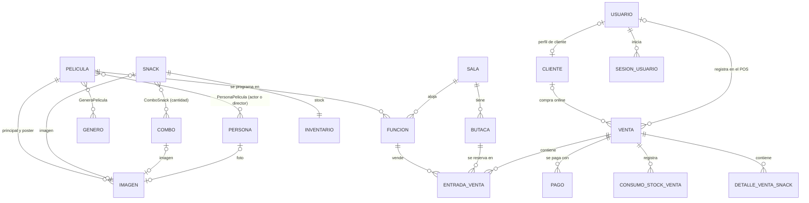
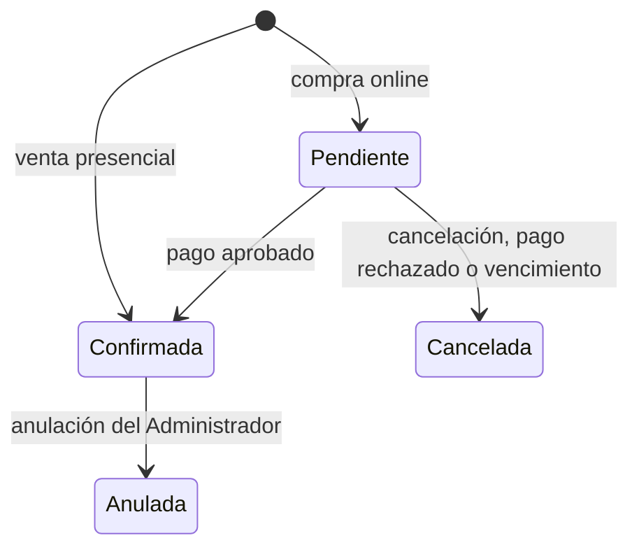

# Proyecto Final: Cinemax

Cinemax es un sistema de gestión para un cine. Cubre la cartelera, la programación de funciones, la reserva de butacas, la venta de entradas y de snacks, el pago y la emisión de comprobantes.

La solución ProyectoFinalProgramacion consta de 4 partes:

- Una API en la que se aloja el backend. Maneja la conexión con la base de datos y la lógica de negocio del cine: funciones, butacas, ventas, reservas, stock y pagos.
- Una aplicación móvil híbrida que permite a los clientes consultar la cartelera, elegir función y butacas, sumar snacks y combos, pagar y obtener el comprobante de su compra.
- Una aplicación web de Blazor pensada para empleados y administradores, con metodología POS. Permite la venta en puerta de entradas y snacks, y administra los recursos del cine mediante pantallas CRUD.
- Un proyecto compartido (Shared) en el que se alojan los DTO y los enums, y que sirve de contrato entre las aplicaciones y el backend.

## Contenido

1. [Accesos](#accesos)
2. [Tecnologías](#tecnologías)
3. [Estructura de la solución](#estructura-de-la-solución)
4. [Modelo de dominio](#modelo-de-dominio)
5. [Roles y funcionalidades](#roles-y-funcionalidades)
6. [Pantallas de las aplicaciones](#pantallas-de-las-aplicaciones)
7. [Flujos del sistema](#flujos-del-sistema)
8. [Autenticación y autorización](#autenticación-y-autorización)
9. [Carrito móvil](#carrito-móvil)
10. [Comprobantes PDF](#comprobantes-pdf)
11. [Referencia de la API](#referencia-de-la-api)
12. [Configuración](#configuración)
13. [Ejecución local](#ejecución-local)
14. [Datos de demostración](#datos-de-demostración)
15. [Estado de integración y limitaciones conocidas](#estado-de-integración-y-limitaciones-conocidas)

## Accesos

| Aplicación | URL |
| --- | --- |
| Web | [https://cinemaxweb.runasp.net/] |
| Backend | [https://cinemaxbackend.runasp.net/] |

## Tecnologías

- .NET 10 y C#.
- ASP.NET Core Web API.
- Blazor WebAssembly Standalone para Web.
- .NET MAUI Blazor Hybrid para Mobile, con foco en Android.
- MudBlazor para los componentes de interfaz.
- Entity Framework Core y PostgreSQL mediante Npgsql.
- JWT para autenticar las solicitudes y refresh tokens para renovar las sesiones.
- BCrypt para los hashes de contraseñas.
- QuestPDF para los comprobantes de venta.
- Serilog para el registro de eventos y errores.
- Un `BackgroundService` que libera automáticamente las reservas vencidas.

## Estructura de la solución

```text
Cinemax.Backend   API, reglas de negocio, repositorios, base de datos y PDFs.
Cinemax.Web       Panel administrativo y punto de venta presencial.
Cinemax.Mobile    Cartelera, carrito, compras y pagos desde la aplicación móvil.
Cinemax.Shared    DTOs, enums y contratos compartidos.
```

El recorrido habitual de una operación es:

```text
Componente Razor
    -> Servicio del cliente
    -> Solicitud HTTP
    -> Controlador del backend
    -> Servicio de negocio
    -> Repositorio
    -> PostgreSQL
```

Los servicios de Web y Mobile se encargan de comunicarse con la API. Los servicios del backend aplican las validaciones y las reglas del negocio.

### Backend

```text
Controllers/         Endpoints HTTP. Traducen las excepciones de negocio a códigos de estado.
Services/            Reglas de negocio (ventas, pagos, funciones, imágenes, stock, sesiones...)
                     y el worker de reservas vencidas.
Repositories/        Interfaces de acceso a datos y de servicios de apoyo (token, unidad de trabajo).
Implementacion/      Repositorios con EF Core y PostgreSQL (sufijo PsqlEF) y la unidad de trabajo.
Data/                DataContext, configuraciones de entidades (Configuraciones/) y datos iniciales.
Models/              Entidades y modelos auxiliares (consultas paginadas, resultados).
Options/             Clases de configuración validadas al iniciar (SalaLayout, Funciones, Ventas...).
Excepciones/         Excepciones de negocio que los controladores convierten en 400, 404 o 409.
PasarelaSimulada/    Pasarela de pago simulada para el flujo de compra online.
GeneracionPDFs/      Documento QuestPDF del comprobante.
Utilidades/          Generador de butacas, validaciones y extensiones de claims.
Migrations/          Migraciones de EF Core.
wwwroot/uploads/     Imágenes subidas (se sirven bajo /uploads).
Logs/                Archivos de registro de Serilog.
```

### Web

```text
Pages/               Pantallas: POS, CRUD de administración, login y alta de empleados.
Components/          Componentes reutilizables: selectores de imagen y de personas, mapa de sala.
Components/Pos/      Los pasos del punto de venta y el resumen de la venta.
Layout/              Diseño principal y menú lateral.
Services/            Clientes de la API, estado de la venta del POS y utilidades de presentación.
```

### Mobile

```text
Components/Pages/Carrito/   Cartelera, funciones, butacas, snacks y carrito.
Components/Pages/Pago/      Pantalla de pago.
Components/Pages/Usuario/   Historial de compras y comprobantes.
Components/Pages/Auth/      Inicio de sesión y registro.
Components/                 Componentes compartidos (barra inferior, imágenes remotas) y diseño.
Services/                   Clientes de la API, carrito, autenticación y utilidades de presentación.
Models/                     Modelo del carrito.
```

### Shared

```text
DTO/      Requests y responses de cada entidad, paginación y comprobantes.
Enums/    Clasificación, formato e idioma de función, método y estado de pago, estado de venta, roles...
Auth/     Contratos de sesión.
```

## Modelo de dominio



### Entidades principales

| Entidad | Descripción |
| --- | --- |
| Película | Título, sinopsis, clasificación, fecha de estreno, duración, si está en cartelera, géneros, actores y directores, y dos imágenes: principal y póster. |
| Género y Persona | Catálogos que se asignan a las películas. Una persona puede ser actor o director según la película. |
| Sala y Butaca | La sala tiene un número. Sus butacas (fila, número, columna y si es accesible) se generan al crearla. |
| Función | Película, sala, formato, idioma, fecha y hora de inicio, fecha de fin y precio de la entrada. |
| Snack | Nombre, precio, unidad de venta, imagen y un inventario con su stock. |
| Combo | Agrupa snacks con una cantidad cada uno y tiene un precio propio, que no es la suma de los componentes. |
| Venta | Una compra, presencial u online. Tiene estado, total, vencimiento (online), cliente y usuario opcionales, entradas, detalle de snacks, consumos de stock y pagos. |
| Entrada de venta | Una butaca de una función dentro de una venta, con su precio congelado. Está activa mientras la reserva o la venta están vigentes. |
| Pago | Método, monto, estado, referencia y fecha. |
| Usuario, Cliente y Sesión | Cuentas con rol, el perfil de cliente que se crea al registrarse desde Mobile, y las sesiones con refresh token. |
| Auditoría | Registro de las operaciones relevantes. |

### Enums

| Enum | Valores |
| --- | --- |
| Rol | Administrador, Cajero, Cliente |
| EstadoVenta | Pendiente, Confirmada, Cancelada, Anulada |
| EstadoPago | Pendiente, Aprobado, Rechazado, Reembolsado |
| MetodoPago | Efectivo, Tarjeta, Transferencia, Qr |
| Clasificación | ATP, +13, +16, +18 |
| FormatoFuncion | 2D, 3D, 4D |
| IdiomaFuncion | Inglés, Español, Francés |
| RolPelicula | Actor, Director |
| TipoImagen | Única, Principal, Póster |

### Estados de una venta



## Roles y funcionalidades

### Administrador

- Administrar películas: datos, géneros, actores, directores, estado de cartelera, imagen principal y póster.
- Administrar géneros y personas (actores y directores), con la foto de cada persona.
- Administrar salas. Las butacas se generan solas al crear la sala, y se puede ver el mapa de cada una.
- Programar funciones: película, sala, formato, idioma, horario y precio de la entrada.
- Administrar snacks y combos: precios, imágenes, componentes y ajuste de stock.
- Dar de alta cuentas de Cajero o Administrador.
- Registrar ventas presenciales desde el POS.
- Consultar el listado de ventas desde Web y descargar sus comprobantes.
- Anular ventas confirmadas: se liberan las butacas, se devuelve el stock y los pagos pasan a reembolsados.

La baja de películas, personas, snacks, combos, funciones y salas es lógica: se conserva el registro con `Eliminado = true`.

### Cajero

- Acceder al punto de venta web.
- Vender entradas, snacks y combos en puerta, o solo snacks y combos, sin entradas.
- Elegir el medio de pago e indicar la referencia cuando corresponda.
- Descargar el comprobante de la venta que acaba de registrar.

### Cliente

- Registrarse desde Mobile e iniciar sesión.
- Elegir película, función y butacas, y sumar snacks y combos a su compra.
- Realizar compras online con una reserva temporal de las butacas y pagar mediante la pasarela simulada.
- Cancelar una compra pendiente o retomar su pago.
- Consultar sus compras y abrir sus comprobantes PDF.

### Visitante

- Consultar la cartelera, las funciones de cada película y el mapa de butacas de una función, sin iniciar sesión.
- Acceder al login y al registro.

Para comprar hace falta una cuenta con rol Cliente. Si un visitante arma una selección y toca continuar, la aplicación lo lleva a iniciar sesión y conserva lo elegido.

## Pantallas de las aplicaciones

### Web

El menú lateral solo se muestra al Administrador. El Cajero trabaja directamente en el punto de venta.

| Ruta | Pantalla | Acceso |
| --- | --- | --- |
| `/pos` | Punto de venta | Administrador y Cajero |
| `/peliculas`, `/peliculas/nueva`, `/peliculas/editar/{id}` | Listado y formulario de películas | Administrador |
| `/generos` | Géneros | Administrador |
| `/personas`, `/personas/nueva`, `/personas/editar/{id}` | Actores y directores | Administrador |
| `/salas` | Salas, con vista del mapa de butacas | Administrador |
| `/funciones`, `/funciones/nueva`, `/funciones/editar/{id}` | Programación de funciones | Administrador |
| `/snacks`, `/snacks/nuevo`, `/snacks/editar/{id}` | Snacks y ajuste de stock | Administrador |
| `/combos`, `/combos/nuevo`, `/combos/editar/{id}` | Combos | Administrador |
| `/ventas` | Historial de ventas | Administrador |
| `/empleados/crear` | Alta de cuentas de empleados | Administrador |

### Mobile

| Ruta | Pantalla | Acceso |
| --- | --- | --- |
| `/catalogo` | Cartelera con búsqueda | Público |
| `/catalogo/{peliculaId}` | Datos de la película y funciones por día | Público |
| `/butacas/{funcionId}` | Mapa de butacas | Público; continuar requiere sesión de Cliente |
| `/snacks` | Snacks y combos (paso opcional) | Cliente |
| `/carrito` | Mi compra | Cliente |
| `/pago/{ventaId}` | Pago | Cliente |
| `/mis-compras` | Historial y comprobantes | Cliente |
| Login y registro | Inicio de sesión y alta de cuenta | Público |

## Flujos del sistema

### Preparación de la cartelera

El orden recomendado para cargar el sistema desde cero es:

1. **Géneros** y **personas** (actores y directores).
2. **Películas**, con sus géneros y reparto. Después se suben la imagen principal y el póster.
3. **Salas**.
4. **Funciones**, que necesitan al menos una película y una sala.
5. **Snacks**, con su stock inicial e imagen.
6. **Combos**, que necesitan snacks ya cargados.

Para que una película aparezca en la cartelera debe tener `EnCartelera` activo, y para que se pueda comprar entradas debe tener funciones futuras.

### Salas y butacas

Al crear una sala, el backend genera sus butacas a partir de la sección `SalaLayout` de la configuración. El diseño predeterminado es:

| Valor | Descripción |
| --- | --- |
| `Filas: 16` | Filas de la A a la P. |
| `Bloques: [4, 11, 4]` | Butacas por bloque en cada fila, separadas por pasillos. |
| `AnchoPasillo: 1` | Columnas vacías entre bloques. |
| `UltimaFilaSinBloqueCentral: true` | La última fila no tiene el bloque central. |
| `UltimaFilaAccesibles` | Números de butaca accesibles de la última fila. |

Cada butaca guarda su fila, su número visible y su columna en la grilla. La columna cuenta los pasillos, de modo que las pantallas dibujan el mapa con una grilla simple y los pasillos quedan como huecos.

### Funciones

- La fecha y la hora se guardan en UTC. Las aplicaciones las convierten a hora de Argentina para mostrarlas y, antes de enviarlas, las pasan de nuevo a UTC.
- El fin de la función es el inicio más la duración de la película más un margen de limpieza (`Funciones:MargenLimpiezaMinutos`).
- Una sala no puede tener dos funciones superpuestas, y una función nueva debe programarse a futuro.
- Si la función ya tiene entradas vendidas o reservadas, solo se puede modificar el precio y no se puede eliminar.
- Una película o una sala con funciones futuras no se puede eliminar.
- El precio de las entradas ya vendidas queda congelado: cambiar el precio de la función no lo modifica.

### Imágenes

Las imágenes se suben aparte de la creación de cada elemento, siempre después de guardarlo, y son opcionales.

| Elemento | Imágenes |
| --- | --- |
| Película | Una principal y un póster |
| Snack, combo y persona | Una sola |

- Formatos permitidos: JPG, JPEG y PNG, de hasta 5 MB. Se valida la extensión y el tipo de contenido.
- Se guardan en `wwwroot/uploads` con un nombre único y se sirven bajo `/uploads`.
- Al reemplazar una imagen, primero se guarda el archivo nuevo, después se actualiza el registro y por último se elimina el archivo anterior.
- La base de datos garantiza una sola imagen por elemento, y una sola principal y un solo póster por película.
- La URL que devuelve la API es absoluta y se arma con el host de la solicitud.
- En los formularios, si la subida falla, el registro queda guardado y al reintentar se actualiza el mismo.

### Snacks, combos e inventario

- Cada snack tiene un inventario con la unidad de venta (balde, vaso, botella...) y su stock.
- El stock se modifica con un ajuste (`POST /api/snacks/{id}/stock`) que suma si el valor es positivo y resta si es negativo. Un ajuste que deje el stock en negativo se rechaza.
- Un combo descuenta el stock de cada uno de sus componentes. Está disponible cuando todos sus componentes tienen stock suficiente.
- Un snack que forma parte de un combo activo no se puede eliminar.
- Al vender, el backend registra exactamente qué se descontó de cada snack. Si la venta se cancela, vence o se anula, se devuelve esa misma cantidad.

### Venta presencial

Desde `/pos`, el Administrador o el Cajero arma la venta en cinco pasos, mientras el panel derecho muestra siempre el detalle:

1. **Película**: se elige de la cartelera, o se salta el paso con "Vender solo snacks".
2. **Función**: se elige el día y el horario.
3. **Butacas**: se eligen en el mapa, hasta el máximo por venta.
4. **Snacks y combos**: es opcional.
5. **Cobro**: método de pago, referencia opcional y, en efectivo, el monto recibido con el vuelto.

`VentaService.CrearVentaPresencial()` libera primero las reservas vencidas y después, dentro de una transacción, valida la función y las butacas, calcula el total a partir de la base de datos, descuenta el stock y registra la venta como confirmada con su pago aprobado.

El POS registra la venta a consumidor final, sin exigir datos del comprador. `ClienteId` puede ser nulo, y `UsuarioId` identifica al empleado que realizó la venta. Este flujo registra el cobro presencial y no utiliza la pasarela simulada.

Una venta solo de snacks es válida y se envía sin función ni butacas. No se pueden vender entradas para una función que ya comenzó. Si dos cajas intentan vender la misma butaca, el backend responde con un 409: el POS muestra el mensaje y permite revisar las butacas, y el mapa se recarga al volver a ese paso.

El estado de la venta en curso vive en un servicio de Blazor (`PosEstadoVenta`) que se mantiene mientras se navega dentro de la sesión.

### Compra online

1. El visitante o cliente elige película, función y butacas. Los snacks y combos son opcionales.
2. En "Mi compra", la aplicación comprueba que la función siga vigente y las butacas libres, y detecta si el cliente ya tiene una compra pendiente.
3. Al continuar, Mobile envía a la API la función, las butacas y los ítems (`POST /api/ventas/online`).
4. El backend identifica al cliente mediante el usuario del JWT, libera las reservas vencidas y rechaza la solicitud si el cliente ya tiene una compra pendiente.
5. Valida las butacas, consulta los precios y el stock, calcula el total y guarda los precios unitarios.
6. Reserva las butacas, descuenta el stock y crea una venta pendiente con vencimiento (`Ventas:MinutosVencimiento`, 15 minutos por defecto).
7. El cliente ve su pago con una cuenta regresiva, elige el medio de pago (Tarjeta, Transferencia o QR) y solicita el cobro.
8. `PagoService` verifica que la venta sea suya, esté pendiente y no haya vencido, y llama a la pasarela simulada.
9. Si el pago se aprueba, la venta queda confirmada. Si se rechaza, la venta se cancela y se liberan las butacas y el stock.
10. Mobile vacía el carrito solo cuando la venta queda confirmada.

El servidor calcula los importes a partir de la base de datos. No toma como válidos precios o totales enviados por el cliente.

La compra online requiere al menos una entrada: no admite ventas solo de snacks. El cliente puede tener una sola compra pendiente a la vez, lo que evita que alguien acapare butacas abriendo compras en serie. Puede cancelar la pendiente (`POST /api/ventas/mis-compras/{id}/cancelar`) o retomar su pago desde "Mis compras".

La implementación actual de `PasarelaPagoSimulada` aprueba todos los pagos. La lógica para tratar un rechazo (cancelar la compra, liberar las butacas y devolver el stock) está implementada.

### Reservas vencidas

Una compra online reserva butacas y stock hasta su vencimiento. Para liberarlos si el cliente abandona el pago:

- `ReservasVencidasWorker` es un servicio en segundo plano que cada 30 segundos llama a `VentaService.LiberarVencidas()`.
- Además, se liberan las vencidas antes de crear cualquier venta, presencial u online.
- Para cada compra vencida, `VencerReserva()` cambia el estado de forma atómica de Pendiente a Cancelada (solo si realmente venció), pasa sus pagos pendientes a rechazados, desactiva sus entradas y devuelve el stock.

El mapa de butacas de una función puede mostrar como ocupadas las butacas de una reserva vencida hasta 30 segundos, hasta que el worker la libere.

### Integridad y concurrencia

- Un índice único sobre la función y la butaca de las entradas activas garantiza que una butaca no se venda dos veces, aunque dos solicitudes lleguen a la vez.
- Un índice único impide tener dos pagos pendientes de la misma venta.
- Los cambios de estado de una venta son atómicos: solo uno de los procesos concurrentes logra cambiarla.
- El descuento de stock también es atómico y falla si no alcanza.
- Las operaciones compuestas (crear una venta, vencer una reserva, aplicar un pago) se ejecutan dentro de una transacción mediante la unidad de trabajo.

### Auditoría

Se registran, con el usuario que las realizó cuando corresponde, las operaciones principales: venta presencial creada, compra online creada, compra cancelada, reserva vencida, pago aprobado, pago rechazado, pago reembolsado por vencimiento y venta anulada.

## Autenticación y autorización

### Inicio de sesión

`POST /api/auth/login` valida las credenciales y devuelve un `LoginResponse` con:

- `Token`: JWT de acceso, con ID de usuario, username, email, rol y vencimiento.
- `RefreshToken`: secreto utilizado para renovar el acceso.
- `SesionExpira`: vencimiento de la sesión asociada al refresh token.

El registro móvil también inicia una sesión y crea los registros relacionados de Usuario y Cliente. La creación administrativa de empleados no reemplaza la sesión del administrador que realiza el alta.

### Almacenamiento y envío

- Web guarda la sesión serializada en `localStorage`.
- Mobile guarda la sesión serializada en `SecureStorage`.
- Las solicitudes autenticadas envían el JWT en `Authorization: Bearer <token>`.

La API valida firma, emisor, destinatario y vencimiento antes de permitir el acceso a los endpoints protegidos. El mecanismo actual no utiliza cookies de autenticación.

### Estado de autenticación en Blazor

`EstadoAutenticacionProvider` obtiene un JWT vigente y construye un `ClaimsPrincipal` con sus claims. Blazor utiliza ese estado en `AuthorizeView` y `AuthorizeRouteView` para mostrar opciones y restringir páginas.

`App.razor` en Web y `Routes.razor` en Mobile actualizan ese estado al navegar. Leer los claims en el cliente sirve para la interfaz; no sustituye la validación y autorización que realiza la API.

### Renovación de sesión

`AutenticacionService` intenta renovar el acceso en dos situaciones:

- `ObtenerTokenVigente()` detecta que el JWT guardado venció.
- Una petición enviada mediante `EnviarAutenticado()` recibe un 401; se intenta renovar y se reenvía una vez con el nuevo token.

No se realiza una renovación por temporizador mientras la aplicación permanece inactiva.

`POST /api/auth/refresh` recibe el refresh token. `SesionService.Renovar()` calcula su hash y busca la sesión en `SesionesUsuarios`. Comprueba que no esté vencida ni revocada y que el usuario siga habilitado.

Si la sesión es válida, genera un JWT y un refresh token nuevos. En la misma fila reemplaza el hash anterior y extiende el vencimiento 30 días desde la renovación. El cliente guarda la nueva respuesta. Así, una sesión puede continuar mediante renovaciones sucesivas mientras siga siendo válida.

Aunque la propiedad de la entidad se llama `RefreshToken`, en la base se almacena su hash, no el secreto original. El refresh anterior deja de funcionar después de la rotación.

### Cierre de sesión y permisos

`POST /api/auth/logout` revoca la sesión identificada por el refresh token. El cliente elimina sus tokens locales. La revocación impide renovar; un JWT de acceso ya emitido puede seguir siendo válido hasta su vencimiento.

Los roles se utilizan tanto en la interfaz como en los endpoints mediante `[Authorize]` y `[Authorize(Roles = "...")]`. Los cambios de rol quedan reflejados al emitir un nuevo JWT. Las compras y comprobantes del cliente incluyen además la comprobación de que la venta le pertenezca.

## Carrito móvil

`CarritoService` conserva la compra en curso: la película, la función, las butacas y los snacks y combos elegidos. Es un servicio de Blazor que mantiene el carrito en memoria mientras se navega entre pantallas.

- **Con sesión**, el carrito se guarda además en `SecureStorage`, separado por usuario mediante una clave como `compra_12`. Persiste al cerrar la aplicación y no se comparte entre cuentas del mismo dispositivo.
- **Sin sesión**, el carrito vive solo en memoria. Si el visitante inicia sesión, la selección pasa a ser de ese usuario. Si se cierra la sesión, el carrito en memoria se vacía, y si entra otro usuario se carga el que esa cuenta tenía guardado.
- Cambiar de película o de función descarta las butacas elegidas.
- El máximo de butacas por compra (10) y de unidades por ítem (50) está en `CarritoService`. El valor de butacas debe coincidir con `Ventas:MaxButacasPorVenta` del backend.
- Para los snacks, cada línea guarda el nombre y el precio en el momento en que se agregó, de modo que la pantalla puede mostrarlos sin consultar la API.
- Las butacas no se reservan hasta el último paso. Al abrir "Mi compra" se vuelve a consultar el mapa de la función: si ya empezó o ya no existe se descartan las entradas, y si alguna butaca se ocupó se quita de la selección.
- El subtotal y el total de la pantalla son informativos: la compra se recalcula en el backend.
- El carrito se vacía únicamente cuando el pago queda aprobado. Si el pago se rechaza, la compra se cancela en el backend pero el carrito queda intacto para volver a intentarlo.

## Comprobantes PDF

QuestPDF genera los comprobantes en el backend a partir de los datos guardados de la venta. `ReporteVenta` recibe `ComprobanteVentaResponse`, que reúne el detalle de la venta y sus pagos sin modificar el DTO general `VentaResponse`.

El documento incluye número, fecha y estado de la venta, cliente o consumidor final, la función con su película, sala y horario, las butacas con su precio, los snacks y combos con sus cantidades, precios unitarios y subtotales, el total y los datos de los pagos: monto, medio, referencia y estado.

| Uso | Endpoint | Acceso |
| --- | --- | --- |
| Comprobante del cliente | `GET /api/ventas/mis-compras/{id}/pdf` | Cliente propietario de la compra |
| Comprobante administrativo y del POS | `GET /api/ventas/{id}/pdf` | Administrador y Cajero |

La API genera el archivo en memoria y lo devuelve con tipo `application/pdf`. No necesita guardar los comprobantes en el disco del servidor.

En Web, el servicio obtiene los bytes con una solicitud autenticada y JavaScript (`wwwroot/js/archivos.js`) inicia la descarga. En Mobile, se guarda una copia temporal en la caché y `Launcher` abre una aplicación compatible con PDF. La impresión depende de las opciones del visor utilizado.

## Referencia de la API

Los endpoints devuelven JSON, salvo los comprobantes PDF. Las fechas viajan en UTC.

### Autenticación

| Método | Ruta | Descripción |
| --- | --- | --- |
| POST | `/api/auth/login` | Inicio de sesión |
| POST | `/api/auth/register` | Registro de un cliente (inicia sesión) |
| POST | `/api/auth/refresh` | Renovación de la sesión |
| POST | `/api/auth/logout` | Revocación de la sesión |

### Cartelera y funciones

| Método | Ruta | Acceso |
| --- | --- | --- |
| GET | `/api/peliculas/cartelera` | Público: películas en cartelera |
| GET | `/api/peliculas` | Administrador: todas las películas |
| GET | `/api/peliculas/{id}` | Público |
| POST, PUT, DELETE | `/api/peliculas`, `/api/peliculas/{id}` | Administrador |
| GET | `/api/funciones/disponibles` | Público: solo funciones futuras. Filtros: `PeliculaId`, `SalaId`, `Desde`, `Hasta` |
| GET | `/api/funciones/{id}/mapa` | Público: butacas de la función y si están ocupadas |
| GET | `/api/funciones`, `/api/funciones/{id}` | Administrador: incluye funciones pasadas |
| POST, PUT, DELETE | `/api/funciones`, `/api/funciones/{id}` | Administrador |
| GET | `/api/generos`, `/api/generos/{id}` | Público |
| POST, PUT, DELETE | `/api/generos`, `/api/generos/{id}` | Administrador |
| GET | `/api/personas`, `/api/personas/{id}` | Público |
| POST, PUT, DELETE | `/api/personas`, `/api/personas/{id}` | Administrador |

### Salas

Todos los endpoints de salas son de Administrador.

| Método | Ruta | Descripción |
| --- | --- | --- |
| GET | `/api/salas`, `/api/salas/{id}` | Listado y detalle |
| GET | `/api/salas/{id}/mapa` | Vista previa del layout de butacas |
| POST, PUT, DELETE | `/api/salas`, `/api/salas/{id}` | Alta, modificación y baja |

### Snacks, combos e imágenes

| Método | Ruta | Acceso |
| --- | --- | --- |
| GET | `/api/snacks/catalogo` | Público: incluye si hay stock |
| GET | `/api/snacks`, `/api/snacks/{id}` | Administrador: incluye el stock |
| POST, PUT, DELETE | `/api/snacks`, `/api/snacks/{id}` | Administrador |
| POST | `/api/snacks/{id}/stock` | Administrador: ajuste de stock |
| GET | `/api/combos`, `/api/combos/{id}` | Público |
| POST, PUT, DELETE | `/api/combos`, `/api/combos/{id}` | Administrador |
| POST | `/api/imagenes/snacks/{id}` | Administrador |
| POST | `/api/imagenes/combos/{id}` | Administrador |
| POST | `/api/imagenes/personas/{id}` | Administrador |
| POST | `/api/imagenes/peliculas/{id}/principal` | Administrador |
| POST | `/api/imagenes/peliculas/{id}/poster` | Administrador |

Los endpoints de imágenes reciben `multipart/form-data` con el archivo en el campo `archivo`.

### Ventas

| Método | Ruta | Acceso |
| --- | --- | --- |
| GET | `/api/ventas`, `/api/ventas/{id}` | Administrador y Cajero |
| POST | `/api/ventas/presencial` | Administrador y Cajero |
| POST | `/api/ventas/online` | Cliente |
| POST | `/api/ventas/{id}/pago` | Cliente |
| GET | `/api/ventas/mis-compras` | Cliente: acepta el filtro `Estado` |
| GET | `/api/ventas/mis-compras/{id}` | Cliente propietario |
| POST | `/api/ventas/mis-compras/{id}/cancelar` | Cliente propietario |
| GET | `/api/ventas/mis-compras/{id}/pdf` | Cliente propietario |
| GET | `/api/ventas/{id}/pdf` | Administrador y Cajero |
| DELETE | `/api/ventas/{id}` | Administrador: anula una venta confirmada |

### Paginación

Los listados aceptan `NumeroPagina` y `TamanoPagina` (20 por defecto, 50 como máximo), además de filtros propios, `OrdenarPor` y `Direccion` (`asc` o `desc`). La respuesta es un `PaginadoResponseDto` con `NumeroPagina`, `TamanoPagina`, `TotalRegistros`, `TotalPaginas`, `TienePaginaAnterior`, `TienePaginaPosterior` y `Datos`.

### Errores

Los controladores traducen las excepciones de negocio a códigos HTTP y devuelven el mensaje como texto, que las aplicaciones muestran tal cual:

| Código | Causa |
| --- | --- |
| 400 | Datos inválidos |
| 401 | Falta de sesión o token vencido |
| 403 | El rol no tiene permiso |
| 404 | El recurso no existe |
| 409 | Conflicto: nombre repetido, función superpuesta, butaca ocupada, stock insuficiente, compra pendiente existente o recurso en uso |
| 500 | Error interno. Un manejador global registra el detalle con Serilog y devuelve un mensaje genérico |

## Configuración

### Backend

Configurar `ConnectionStrings:DefaultConnection` y los valores de `JwtSettings`: `Key`, `Issuer`, `Audience` y `ExpiryMinutes`. Utilizar User Secrets en desarrollo o la configuración del entorno del hosting; no publicar contraseñas ni claves de firma en el repositorio.

| Sección | Descripción |
| --- | --- |
| `Cors:Origenes` | Direcciones de Web que pueden consumir la API desde el navegador. |
| `SalaLayout` | Diseño de las butacas que se generan al crear una sala. |
| `Funciones:MargenLimpiezaMinutos` | Minutos que se suman al fin de cada función (0 a 120). |
| `Ventas:MinutosVencimiento` | Minutos de vigencia de una compra online pendiente (1 a 120). |
| `Ventas:MaxButacasPorVenta` | Máximo de entradas por venta (1 a 30). |
| `Serilog` | Salida y nivel de los registros. |

Las secciones `SalaLayout`, `Funciones` y `Ventas` se validan al iniciar: si tienen valores inválidos, la API no arranca.

### Web

Web configura la URL de la API en `Apis:Cinemax`, dentro de sus archivos `wwwroot/appsettings.*.json`. Las pantallas convierten los horarios a hora de Argentina.

### Mobile

`ConfiguracionApi` selecciona la API según la compilación. Las pantallas usan la hora de Argentina para mostrar las funciones.

El máximo de butacas por venta está definido en tres lugares, y los tres deben coincidir: `Ventas:MaxButacasPorVenta` en el backend, `PosService.MaxButacasPorVenta` en Web y `CarritoService.MaxButacas` en Mobile.

## Ejecución local

### Requisitos

- SDK de .NET 10.
- PostgreSQL y una base de datos configurada para la API.
- Visual Studio con soporte para ASP.NET y, para Mobile, .NET MAUI y Android.
- Android SDK y emulador o dispositivo compatible.
- Herramienta `dotnet-ef` compatible con EF Core 10 para aplicar migraciones.

### Base de datos y backend

Aplicar las migraciones desde la raíz de la solución:

```powershell
dotnet ef database update --project Cinemax.Backend --startup-project Cinemax.Backend
```

Al iniciar, `SeedDatos.CrearAdministrador()` crea la cuenta de demostración `admin` con contraseña `admin` si no existe un usuario con ese nombre. No modifica la contraseña de una cuenta ya creada.

### Backend y Web

Ejecutar en dos terminales distintas, desde la raíz de la solución:

```powershell
dotnet run --project Cinemax.Backend --launch-profile https
```

```powershell
dotnet run --project Cinemax.Web --launch-profile https
```

| Servicio | Dirección local |
| --- | --- |
| Backend HTTPS | `https://localhost:7272` |
| Backend HTTP | `http://localhost:5156` |
| Web HTTPS | `https://localhost:7248` |
| Web HTTP | `http://localhost:5215` |
| Documento OpenAPI | `https://localhost:7272/openapi/v1.json` |

OpenAPI se publica únicamente en el entorno `Development`. Los puertos pueden variar según el archivo `Properties/launchSettings.json` de cada proyecto.

### Mobile

Seleccionar `Cinemax.Mobile` y un emulador Android en Visual Studio. Iniciar el backend junto con Mobile cuando se utilice la configuración Debug.

`ConfiguracionApi` selecciona la API según la compilación:

| Configuración | API utilizada |
| --- | --- |
| Debug en Android Emulator | `https://10.0.2.2:7272/` |
| Debug en otras plataformas | `https://localhost:7272/` |
| Release | `https://cinemaxbackend.runasp.net/` |

En Android Emulator, `10.0.2.2` permite acceder al backend del equipo de desarrollo. Para ejecutar en un teléfono físico contra una API local hay que adaptar la dirección a una accesible desde ese dispositivo.

**Imágenes en Android con la API local.** El `HttpClient` de la aplicación acepta el certificado de desarrollo, pero el WebView que muestra la interfaz no. Por eso, solo en compilaciones Debug para Android, `ImagenCacheService` descarga las imágenes con el `HttpClient` y las muestra como `data:` URI. En el resto de los casos, incluida la versión publicada, se usa la URL normal.

### Probar el sistema de punta a punta

1. Iniciar el backend y la Web, e ingresar con `admin`.
2. Cargar géneros, personas, películas, salas, funciones, snacks y combos (o usar los datos de demostración).
3. Registrar una venta desde `/pos`.
4. Crear una cuenta de Cajero desde `/empleados/crear` y comprobar que solo accede al POS.
5. Registrar un cliente desde la aplicación móvil y completar una compra: cartelera, función, butacas, snacks, pago y comprobante.
6. Dejar una compra pendiente sin pagar y comprobar que las butacas se liberan al vencer.

## Datos de demostración

Cuando la API se ejecuta en el entorno `Development`, `SeedDatos.CrearDatosDemo()` carga datos de ejemplo para poder probar sin cargar todo a mano. Solo actúa si todavía no existe ninguna película, por lo que no duplica datos al reiniciar.

Crea:

- Seis géneros y seis personas.
- Dos salas con sus butacas.
- Cinco películas, una de ellas fuera de cartelera, sin imágenes. Se pueden subir desde los formularios de administración.
- Funciones para el día actual y los tres siguientes, a las 15, 18 y 21 h (hora de Argentina) en cada sala. Se omiten los horarios que ya pasaron.
- Tres snacks con stock y un combo.

## Estado de integración y limitaciones conocidas

- La `PasarelaPagoSimulada` aprueba todos los pagos. La rama de rechazo (cancelar la compra, liberar butacas y stock) existe, pero la pasarela actual no la ejercita.
- El comprobante PDF arma la descripción de la función con la hora en UTC, sin convertirla a hora de Argentina. Está pendiente convertirla en el backend.
- Las pantallas de Web y Mobile convierten los horarios con la zona `America/Argentina/Buenos_Aires` fija. Si el cine opera en otra zona, hay que cambiarla en `ZonaHoraria` de cada aplicación.
- El POS no permite vender entradas para una función que ya comenzó. Esa regla la aplica el backend.
- Los endpoints GET del listado general y del detalle de ventas admiten Administrador y Cajero, y el comprobante administrativo también. La pantalla de historial de Web es exclusiva del Administrador. Si la consulta debe ser exclusiva del Administrador en la API, hay que alinear esa configuración.
- Las imágenes se guardan en el disco del servidor (`wwwroot/uploads`). En un hosting que reemplace los archivos en cada despliegue, hay que conservar esa carpeta o migrar el almacenamiento.
- Las ventas presenciales no registran datos del comprador. La API acepta un `ClienteId` opcional, pero el POS no tiene una búsqueda de clientes.
